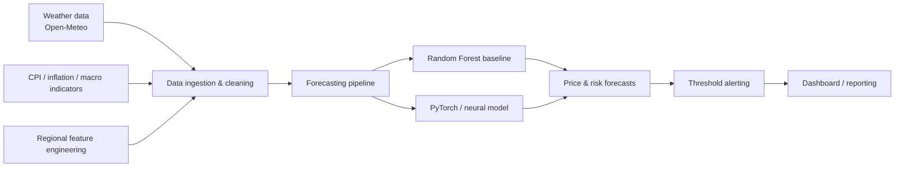

# AgriShield

> Food security forecasting and early-warning system for climate-aware price and shortage-risk analysis.

## Overview

AgriShield is a machine-learning project focused on forecasting food-price pressure and shortage risk using weather, macroeconomic, and regional indicators. It was developed as a research-driven system for early warning in food-security planning, with emphasis on applied forecasting and operational risk detection.

## Problem statement

Food systems are sensitive to climate variability, inflation pressure, transport cost changes, and broader regional risk factors. AgriShield explores whether these signals can be modeled to anticipate food-price stress and shortage risk early enough to support intervention or monitoring workflows.

## System architecture



## Data pipeline

The workflow ingests and consolidates multiple signals into a single forecasting dataset:

- weather variables such as temperature and precipitation
- inflation and CPI signals from macroeconomic data sources
- regional and qualitative risk conditions
- food-price index and shortage-risk ground truth values

These inputs are engineered into time-aware feature sets and used to train predictive models for future price and risk outcomes.

## Machine learning approach

The repository evaluates multiple modeling strategies for two forecasting objectives:

1. future food-price index prediction
2. future shortage-risk score prediction

The project includes a Random Forest baseline and a neural-network approach, with the objective of comparing standard and advanced forecasting methods under the same feature pipeline.

## Verified model results

The current model outputs in `dashboard_v2/train_results.json` show the following validation metrics from the execution run available in the repo:

| Model | Target | RMSE | R² |
| --- | --- | ---: | ---: |
| Random Forest | Price forecast | 19.15 | 0.7997 |
| PyTorch / MLP | Price forecast | 18.39 | 0.8154 |
| Random Forest | Shortage risk | 5.57 | 0.7874 |
| PyTorch / MLP | Shortage risk | 4.83 | 0.8397 |

These results are based on the training artifacts present in the repository and should be interpreted as project evidence, not as an externally benchmarked production claim.

## GPU acceleration note

The repo includes RAPIDS-oriented tooling and GPU-capable design patterns for acceleration. In the model execution artifact currently committed to the project, the reported device was `cpu` and `gpu_model` was `None`, so the GPU acceleration is treated as a design feature and tooling path rather than a verified local GPU runtime result in this environment.

## Tech stack

- Python
- Jupyter notebooks
- pandas / NumPy
- scikit-learn
- PyTorch
- NVIDIA RAPIDS (cuDF, cuML)
- matplotlib
- weather and CPI data ingestion

## Project status

This project is best understood as a research and prototype system focused on applied ML for food-security analytics and decision support.

## Running locally

1. Open the notebooks in the repository root to inspect the data pipeline and modeling workflow.
2. Install the required Python packages for the notebook and training environment.
3. Run the forecasting pipeline or dashboard notebook to reproduce the analysis.

### Dashboard ML package

The shared Python implementation lives in `dashboard_v2/agri_shield_ml`. From `dashboard_v2`, run
`python train_deep_learning.py` to preserve the dashboard's `train_results.json`
output and write immutable, version-named weight/manifest pairs
(`pytorch_food_security_model.<version>.pth` and
`pytorch_food_security_model.<version>.manifest.json`). The manifest identifies
the artifact schema/version, ordered feature names, fitted feature/target
scalers, evaluation metrics, feature/output population baselines, calibrated
prediction interval widths, and SHA-256 digest of the weights. Use
`python smoke_test_ml_package.py` for a small feature/artifact round-trip check.
Training reports four grouped walk-forward folds (six validation months per
fold, with a three-month forecast-horizon gap) in the JSON `validation`
section. Run `python train_deep_learning.py --validation-only --epochs 1` for
a short validation-only evaluation without production training or artifact
writes.

### Versioned dashboard API

The dashboard can run through the Python standard-library HTTP server (no web
framework dependency). From `dashboard_v2`, start it with:

```powershell
python api_server.py
```

Open `http://127.0.0.1:8000/`. The versioned API exposes `GET /v1/health`,
`POST /v1/predict`, `GET /v1/models`, `GET /v1/audit`, and `GET /v1/monitoring`.
The dashboard uses
the API for startup forecasts, custom-region recalculation, and simulator
predictions. If the service is unreachable, it explicitly switches to the
existing in-browser pipeline. Opening `index.html` directly therefore remains
available as an offline fallback.

`model_registry.json` persistently selects the active model version and binds
its artifact manifest by SHA-256. With no `AGRISHIELD_ARTIFACT_KEY`, this
manifest digest detects accidental changes but is not an authenticity
signature. For authenticated verification, set a private key and explicitly
sign the current manifest before starting the server:

```powershell
$env:AGRISHIELD_ARTIFACT_KEY = "use-a-secret-from-your-secret-manager"
python api_server.py --sign-registry
python api_server.py
```

When the key is set, the registry must contain a matching HMAC-SHA256
signature; the server refuses unsigned or modified manifests. Do not commit
the key. Prediction audit entries include model version, ordered feature
names, UTC timestamp, request/response SHA-256 hashes, and a chained audit
hash, persisted to the ignored `audit.jsonl` file. API and training events are
emitted as one-record-per-line JSON logs. Prediction monitoring statistics are
persisted without raw feature values in the ignored `monitoring.jsonl` file.
The monitor compares request feature/output populations to the baseline in each
model manifest, reporting mean/std z-scores and PSI (drift thresholds: z-score
3 or PSI 0.2). Newly trained artifacts include a 90% marginal interval
calibrated from walk-forward validation absolute errors. Older artifacts without
that calibration use a labeled normal approximation based on validation RMSE;
intervals are not joint or conditional coverage guarantees. Existing manifests
without prediction-population baselines report feature z-scores from their
scalers; prediction drift comparisons begin after a model is trained with the
new monitoring metadata.

#### Configure and deploy

The API accepts these environment variables; matching CLI flags override them:

| Environment variable | CLI flag | Default | Purpose |
| --- | --- | --- | --- |
| `AGRISHIELD_HOST` | `--host` | `127.0.0.1` | Bind address (`0.0.0.0` inside a container) |
| `AGRISHIELD_PORT` | `--port` | `8000` | Listen port, from 0 to 65535 |
| `AGRISHIELD_ARTIFACT_KEY` | `--artifact-key` | unset | Require HMAC verification of the active manifest |
| `AGRISHIELD_AUDIT_PATH` | `--audit-path` | `audit.jsonl` under dashboard root | Chained prediction audit log |
| `AGRISHIELD_REGISTRY_PATH` | `--registry-path` | `model_registry.json` under dashboard root | Active model registry |
| `AGRISHIELD_DASHBOARD_ROOT` | `--dashboard-root` | API directory | Static dashboard and default artifact directory |
| `AGRISHIELD_LOG_LEVEL` | `--log-level` | `INFO` | `CRITICAL`, `ERROR`, `WARNING`, `INFO`, or `DEBUG` |

Relative audit and registry paths are resolved from the dashboard root. A
configured artifact key must be non-empty and match an HMAC signature already
stored in the registry; the API does not sign artifacts during startup. Missing,
invalid, or mismatched registries/manifests, unreadable model artifacts,
unwritable audit storage, invalid configuration, and port binding failures stop
startup with an `AgriShield startup failed` message. Check `GET /v1/health` for
the loaded API and model version. Invalid JSON, schema, and feature requests
return HTTP 400; oversized prediction bodies return 413; unknown `/v1` routes
return 404; unexpected prediction failures return a generic HTTP 500 and are
recorded in the structured server logs.

Run with Docker Compose from the repository root:

```powershell
Copy-Item .env.example .env
docker compose up --build -d
docker compose ps
Invoke-RestMethod http://127.0.0.1:8000/v1/health
docker compose logs -f agrishield-api
```

Set `AGRISHIELD_PORT` in `.env` to change both the container listen port and
published host port. Keep `AGRISHIELD_ARTIFACT_KEY` unset when using the
unsigned default registry. To enforce signed-manifest verification, set the
key in the deployment environment and use a registry signed with that same
key; never commit `.env` or the secret. Compose persists audit/monitoring logs
in the `agrishield-data` named volume. Model registry and artifacts are baked
into the image, so rebuild after changing them. The container healthcheck polls
`/v1/health`; an unhealthy state means startup did not complete or the API is
not responding. This API has no client authentication; do not expose it directly
to untrusted networks.

#### Registering and rolling back models

Training writes immutable, version-named weight/manifest pairs rather than
overwriting the active model. From `dashboard_v2`, train a candidate and inspect
the registry:

```powershell
python train_deep_learning.py --model-version candidate-20261126
python model_registry.py --list
```

Register the resulting manifest after validation. If
`AGRISHIELD_ARTIFACT_KEY` is configured, keep it available in this shell so
registration signs the candidate manifest:

```powershell
python model_registry.py --register candidate-20261126 `
  --manifest pytorch_food_security_model.candidate-20261126.manifest.json
python model_registry.py --activate candidate-20261126 --reason "validation approved"
python api_server.py
```

Each model version remains in the registry, and `rollback_metadata` records
activation and rollback history. The server loads the active model at startup,
so restart it after activation. To revert, select a previously registered
version and restart the API process:

```powershell
python model_registry.py --list
python model_registry.py --rollback 1.0.0 --reason "candidate drifted"
python api_server.py
```

Rollback verifies the selected manifest digest (and HMAC when configured)
before atomically switching the active registry pointer. Keep candidate and
previous model weight/manifest files together in `dashboard_v2`; do not delete
registered artifacts needed for recovery.

Run the API unit tests from `dashboard_v2`:

```powershell
python -m unittest discover -s tests -p "test_*.py"
```

Run the dashboard JavaScript checks with `node tests/test_app_parsing.js`,
`node tests/test_dashboard_fallback.js`, and `node tests/test_api_client.js`.

## Limitations and future work

- This is a prototype data-science workflow rather than a production operational platform.
- Forecast accuracy depends on data quality and region coverage.
- The system can be extended with live ingestion, stronger evaluation pipelines, and more robust deployment workflows.
