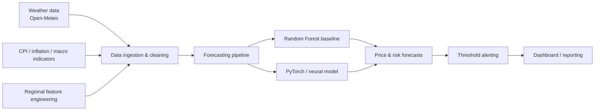

# AgriShield

> Food security forecasting and early-warning system for climate-aware price and shortage-risk analysis.

## Overview

AgriShield is a machine-learning project focused on forecasting food-price pressure and shortage risk using weather, macroeconomic, and regional indicators. It was developed as a research-driven system for early warning in food-security planning, with emphasis on applied forecasting and operational risk detection.

## Problem statement

Food systems are sensitive to climate variability, inflation pressure, transport cost changes, and broader regional risk factors. AgriShield explores whether these signals can be modeled to anticipate food-price stress and shortage risk early enough to support intervention or monitoring workflows.

## System architecture

## Data pipeline

The workflow ingests and consolidates multiple signals into a single forecasting dataset:

- weather variables such as temperature and precipitation
- inflation and CPI signals from macroeconomic data sources
- regional and qualitative risk conditions
- food-price index and shortage-risk ground truth values

These inputs are engineered into time-aware feature sets and used to train predictive models for future price and risk outcomes.

## Machine learning approach

The repository evaluates multiple modeling strategies for two forecasting objectives:

1. future food-price index prediction
2. future shortage-risk score prediction

The project includes a Random Forest baseline and a neural-network approach, with the objective of comparing standard and advanced forecasting methods under the same feature pipeline.

## Verified model results

The current model outputs in `dashboard_v2/train_results.json` show the following validation metrics from the execution run available in the repo:

| Model | Target | RMSE | R² |
| --- | --- | ---: | ---: |
| Random Forest | Price forecast | 19.15 | 0.7997 |
| PyTorch / MLP | Price forecast | 18.39 | 0.8154 |
| Random Forest | Shortage risk | 5.57 | 0.7874 |
| PyTorch / MLP | Shortage risk | 4.83 | 0.8397 |

These results are based on the training artifacts present in the repository and should be interpreted as project evidence, not as an externally benchmarked production claim.

## GPU acceleration note

The repo includes RAPIDS-oriented tooling and GPU-capable design patterns for acceleration. In the model execution artifact currently committed to the project, the reported device was `cpu` and `gpu_model` was `None`, so the GPU acceleration is treated as a design feature and tooling path rather than a verified local GPU runtime result in this environment.

## Tech stack

- Python
- Jupyter notebooks
- pandas / NumPy
- scikit-learn
- PyTorch
- NVIDIA RAPIDS (cuDF, cuML)
- matplotlib
- weather and CPI data ingestion

## Project status

This project is best understood as a research and prototype system focused on applied ML for food-security analytics and decision support.

## Running locally

1. Open the notebooks in the repository root to inspect the data pipeline and modeling workflow.
2. Install the required Python packages for the notebook and training environment.
3. Run the forecasting pipeline or dashboard notebook to reproduce the analysis.

## Limitations and future work

- This is a prototype data-science workflow rather than a production operational platform.
- Forecast accuracy depends on data quality and region coverage.
- The system can be extended with live ingestion, stronger evaluation pipelines, and more robust deployment workflows.
